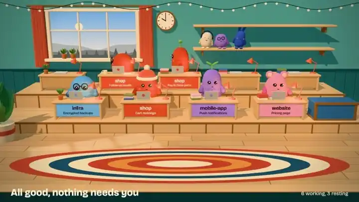

# Fluffice

**Un bureau de peluches sur ton deuxième écran, qui montre quelle session Claude Code a besoin de toi.**

[](https://cdn.jsdelivr.net/gh/yagami271/fluffice@main/docs/demo.mp4)

[Voir avec le son](https://cdn.jsdelivr.net/gh/yagami271/fluffice@main/docs/demo.mp4) · [Read in English](README.md)

Avec plusieurs sessions Claude Code en même temps, on ne sait plus laquelle a fini et laquelle est bloquée. Fluffice fait de chaque session un petit collègue. Ceux qui travaillent restent tranquilles à leur bureau. Ceux qui ont besoin de toi viennent devant, avec une pancarte.

## Installer

Il te faut [Claude Code](https://code.claude.com) et Node.js 20 ou plus récent.

**Essayer une fois**

```bash
npx github:yagami271/fluffice
```

**Le garder, comme plugin Claude Code**

```bash
claude plugin marketplace add yagami271/fluffice && claude plugin install fluffice@fluffice
```

Le bureau démarre alors avec ta prochaine session Claude Code, et s'ouvre dans ton navigateur la première fois. Ensuite, tape `/fluffice:open` pour le voir et `/fluffice:stop` pour le fermer. Pour mettre à jour : `claude plugin update fluffice@fluffice`.

Il n'y a rien à configurer. Mets la page sur un écran libre, en plein écran.

## Ce que tu vois

| Session | Dans le bureau |
| --- | --- |
| Au travail | À sa place, lampe allumée, presque immobile |
| Terminée | Vient sur le tapis avec une pancarte verte |
| Attend ton accord, ou te pose une question | Vient encore plus près avec une pancarte jaune, et fait signe |
| Vue, il y a moins de 2 heures | De retour à sa place, lampe éteinte |
| Inactive depuis plus longtemps | Dort sur l'étagère |

- **La couleur et le motif désignent le projet, l'accessoire désigne la session.** Une session garde son apparence toute sa vie, et celles d'un même projet s'assoient côte à côte.
- **Les noms viennent de Claude Code.** Fluffice reprend le titre que Claude Code donne déjà à chaque session, ou le tien si tu l'as renommée.
- **Seul ce qui t'attend bouge.** Les sessions au travail restent calmes exprès, pour que ton œil aille au bon endroit.
- **Répondre suffit.** Dès qu'une session reprend le travail, son personnage aussi. Tu peux aussi cliquer sur une session terminée pour l'envoyer se reposer.
- **La pièce suit ta journée**, de la lumière du matin aux lampes du soir.

### Avec beaucoup de sessions

La scène garde la même taille à 9 ou à 200 sessions. Cinq personnages au plus se tiennent devant, les demandes d'abord, et le suivant avance quand tu en traites un. Au-delà de neuf sessions au travail, les bureaux sont partagés par projet. Les plus anciens dormeurs vont dans le coffre à peluches.

### Le son

Le son est coupé tant que tu n'as pas cliqué sur *Son coupé*, car les navigateurs exigent un clic. Chaque projet a sa note : tu apprends à le reconnaître sans regarder. Deux sons seulement sont des alertes : trois notes qui montent quand une session a fini, et quelqu'un qui frappe à la porte quand elle a besoin de toi. Tous les sons sont fabriqués dans la page, sans fichier audio. Le volume baisse de moitié entre 22 h et 8 h.

## Vie privée

- Fluffice tourne sur ta machine et n'écoute que `127.0.0.1`. Il n'envoie rien, et la page ne charge rien depuis Internet.
- Il lit les fichiers de session dans `~/.claude/sessions`, et la fin de chaque transcription pour trouver le titre. Tes messages ne sont jamais affichés ni enregistrés.
- Les sites que tu visites ne peuvent pas le lire. Les autres comptes du même ordinateur peuvent voir tes noms de projets et titres de sessions : évite-le sur une machine partagée.
- Il retient les apparences, les places et ce que tu as vu dans `~/.fluffice/memory.json`.

## Options

| Commande | |
| --- | --- |
| `fluffice --no-open` | Démarrer sans ouvrir le navigateur |
| `fluffice --background` | Démarrer en arrière-plan, s'il ne tourne pas déjà |
| `fluffice --stop` | Arrêter le bureau lancé en arrière-plan |
| `PORT=4800 fluffice` | Utiliser un autre port |

Avec `npx`, écris `npx github:yagami271/fluffice --no-open`.

Dans la barre d'adresse, `?demo=1` montre des sessions d'exemple, `?lang=en` ou `?lang=fr` choisit la langue, et `?hour=22` règle l'heure.

## Bon à savoir

- Les fichiers de session sont internes à Claude Code et non documentés. Une mise à jour peut les changer, et Fluffice devra alors suivre.
- Il couvre les sessions du terminal et de l'app desktop de cette machine, pas les sessions cloud.
- Il est développé et utilisé sur macOS. Linux et Windows devraient marcher, mais n'ont pas été testés.

## Contribuer

Il n'y a ni étape de construction ni dépendance à installer.

```bash
git clone https://github.com/yagami271/fluffice.git
cd fluffice
npm run dev
npm test
```

| Fichier | Rôle |
| --- | --- |
| `server.mjs` | Lit les sessions et les envoie à la page |
| `public/js/assign.js` | Qui ressemble à quoi et se tient où |
| `public/js/main.js` | Mise en scène, texte et interaction |
| `public/js/room.js`, `creature.js` | La pièce et ses habitants |
| `public/js/sound.js` | Les sons |
| `public/js/i18n.js` | Anglais et français. Les autres langues sont bienvenues |

## Licence

[MIT](LICENSE). Le projet embarque [three.js](https://threejs.org) (MIT) et [Bricolage Grotesque](https://github.com/ateliertriay/bricolage) (SIL Open Font License).

Fluffice est un projet indépendant, sans lien avec Anthropic.
