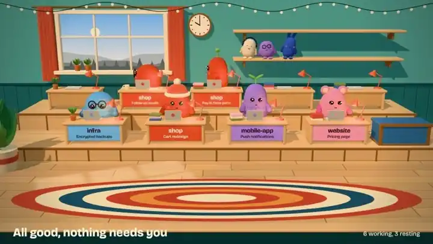

# Fluffice

**A plush office on your second screen that shows which Claude Code session needs you.**

[](https://cdn.jsdelivr.net/gh/yagami271/fluffice@main/docs/demo.mp4)

[Watch it with sound](https://cdn.jsdelivr.net/gh/yagami271/fluffice@main/docs/demo.mp4) · [Lire en français](README.fr.md)

When several Claude Code sessions run at once, it is easy to lose track of which one has finished and which one is stuck. Fluffice turns each session into a little colleague. The ones that work stay quietly at their desk. The ones that need you walk up to the front and hold a sign.

## Install

You need [Claude Code](https://code.claude.com) and Node.js 20 or later.

**Try it once**

```bash
npx github:yagami271/fluffice
```

**Keep it, as a Claude Code plugin**

```bash
claude plugin marketplace add yagami271/fluffice && claude plugin install fluffice@fluffice
```

The office then starts with your next Claude Code session, and opens in your browser the first time. After that, type `/fluffice:open` to see it, `/fluffice:link` to show it in another browser, and `/fluffice:stop` to close it.

There is nothing to configure. Put the page on a spare screen and make it full screen.

## What you see

| Session | In the office |
| --- | --- |
| Working | At its desk, lamp on, almost still |
| Done | Walks to the rug with a green sign |
| Needs your OK, or has a question | Walks even closer with a yellow sign, and waves |
| Seen, less than 2 hours ago | Back at its desk, lamp off |
| Idle for longer | Asleep on the shelf |

- **Color and pattern are the project, the accessory is the session.** A session keeps its look for its whole life, and sessions of one project sit side by side.
- **Names come from Claude Code.** Fluffice uses the title Claude Code already gives each session, or yours if you renamed it.
- **Only what needs you moves.** Working sessions stay calm on purpose, so your eye goes to the right place.
- **Answering is enough.** As soon as a session goes back to work, so does its character. You can also click a finished one to send it to rest.
- **The room follows your day**, from morning light to desk lamps at night.

### With many sessions

The scene keeps the same size with 9 sessions or 200. At most five characters stand in front, requests first, and the next in line moves up when you handle one. Past nine working sessions, desks are shared by project. Older sleepers go in the toy chest.

### Sound

Sound is off until you click *Sound off*, because browsers require a click. Each project has its own note, so you learn to recognize it without looking. Only two sounds are alerts: three rising notes when a session is done, and a knock at the door when it needs you. All sounds are made in the page, there are no audio files. The volume is halved between 10 pm and 8 am.

## Privacy

- Fluffice runs on your machine and listens on `127.0.0.1` only. It sends nothing anywhere, and the page loads nothing from the internet.
- It reads the session files in `~/.claude/sessions`, and the end of each transcript to find the title. Your messages are never shown or stored.
- Other accounts of the same computer cannot read it: each browser is connected once, with a one-time key. `fluffice` does it for you, and `fluffice --link` does it for another browser.
- It remembers looks, desks and what you have seen in `~/.fluffice/memory.json`.

## Options

| Command | |
| --- | --- |
| `fluffice --no-open` | Start without opening the browser |
| `fluffice --background` | Start in the background, if not already running |
| `fluffice --link` | Print a link that connects another browser, good for 10 minutes |
| `fluffice --stop` | Stop the office running in the background |
| `PORT=4800 fluffice` | Use another port |

With `npx`, write `npx github:yagami271/fluffice --no-open`.

In the address bar, `?demo=1` shows sample sessions, `?lang=en` or `?lang=fr` picks the language, and `?hour=22` sets the time of day.

## Good to know

- The session files are internal to Claude Code and not documented. An update can change them, in which case Fluffice will need one too.
- It covers sessions from the terminal and from the desktop app on this machine, not cloud sessions.
- It is built and used on macOS. Linux and Windows should work but have not been tested.

## Contributing

There is no build step and no dependency to install.

```bash
git clone https://github.com/yagami271/fluffice.git
cd fluffice
npm run dev
npm test
```

| File | Role |
| --- | --- |
| `server.mjs` | Reads the sessions and streams them to the page |
| `public/js/assign.js` | Who looks like what and stands where |
| `public/js/main.js` | Staging, text and interaction |
| `public/js/room.js`, `creature.js` | The room and its inhabitants |
| `public/js/sound.js` | Sounds |
| `public/js/i18n.js` | English and French. New languages are welcome |

## License

[MIT](LICENSE). It ships [three.js](https://threejs.org) (MIT) and [Bricolage Grotesque](https://github.com/ateliertriay/bricolage) (SIL Open Font License).

Fluffice is an independent project. It is not affiliated with or endorsed by Anthropic.
